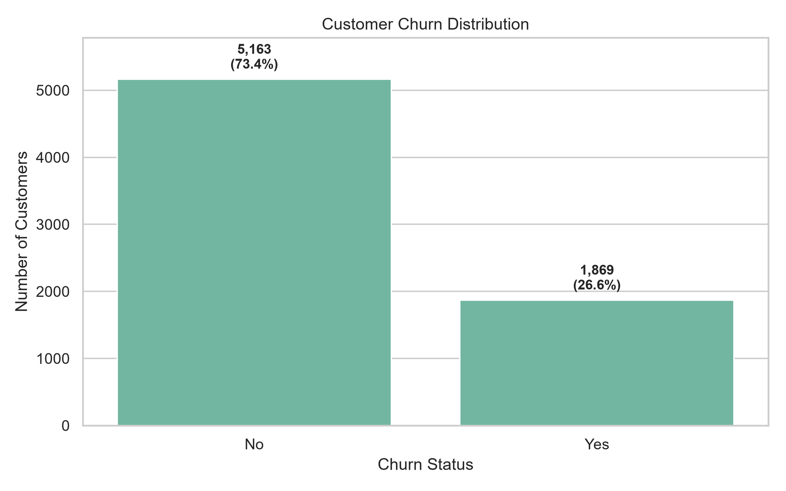
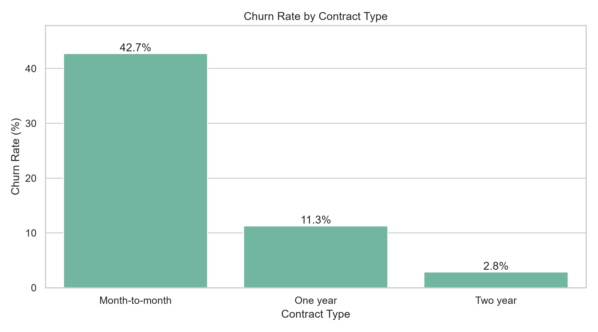
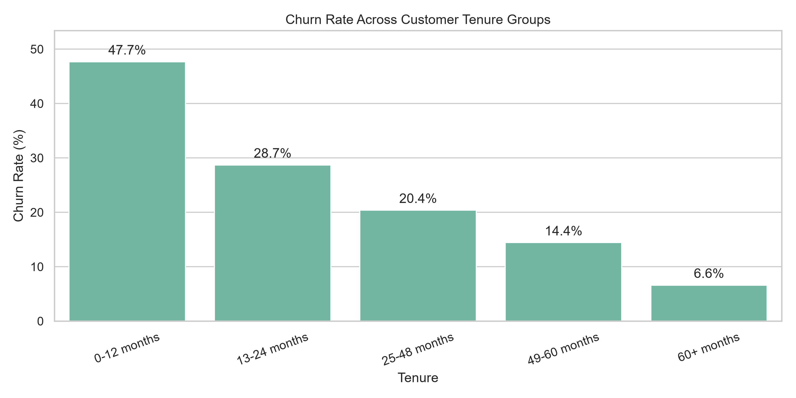
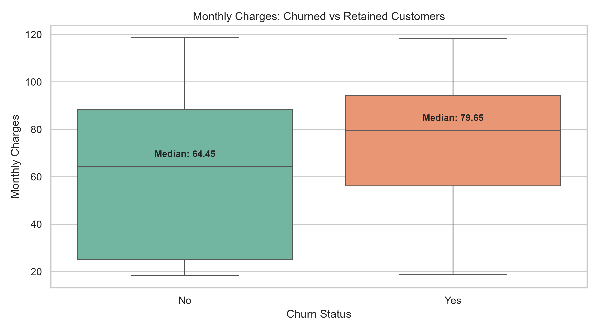
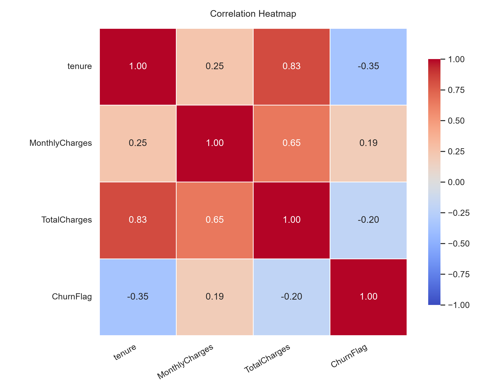

# Customer Churn Analysis & Visualization

## Project Overview

This project analyzes customer churn for a telecommunications company using Python. It explores customer behavior, identifies customer segments with higher churn rates, creates visualizations, and generates business insights to support customer retention strategies.

## Objectives

- Clean and validate customer data.
- Perform exploratory data analysis (EDA).
- Analyze churn across different customer segments.
- Visualize churn patterns and customer characteristics.
- Generate data-driven business recommendations.

## Technology Stack

- **Python** — core programming language
- **Pandas** — data manipulation and analysis
- **NumPy** — numerical operations
- **Matplotlib** — data visualization
- **Seaborn** — statistical visualizations
- **Git and GitHub** — version control and project hosting

## Dataset

This project uses the IBM Telco Customer Churn dataset.

**Source:** [Telco Customer Churn Dataset on Kaggle](https://www.kaggle.com/datasets/blastchar/telco-customer-churn)

Download the dataset and save the CSV file at:

`data/customer_churn.csv`

The raw dataset is excluded from version control. Download it from Kaggle before running the project.

## Project Structure

```text
Customer-Churn-Analysis/
├── data/
│   └── customer_churn.csv
├── outputs/
│   ├── figures/
│   │   ├── churn_distribution.png
│   │   ├── churn_by_contract.png
│   │   ├── churn_by_tenure.png
│   │   ├── monthly_charges_by_churn.png
│   │   └── correlation_heatmap.png
│   └── reports/
│       ├── eda_summary.csv
│       ├── churn_by_contract.csv
│       ├── churn_by_tenure.csv
│       ├── correlation_matrix.csv
│       ├── customer_segment_analysis.csv
│       ├── high_churn_segments.csv
│       └── business_insights.txt
├── src/
│   ├── __init__.py
│   ├── data_cleaning.py
│   ├── exploratory_analysis.py
│   ├── customer_segmentation.py
│   └── business_insights.py
├── main.py
├── requirements.txt
├── .gitignore
└── README.md
```

## Key Findings

Analysis of the cleaned dataset produced the following findings:

- **7,032 customers** were included after data cleaning.
- **1,869 customers churned**, representing an overall churn rate of **26.58%**.
- Churned customers had an average tenure of **17.98 months**, compared with **37.65 months** for retained customers.
- Churned customers had average monthly charges of **74.44**, compared with **61.31** for retained customers, in the dataset's currency units.
- Month-to-month contracts had a churn rate of **42.71%**.
- Customers using electronic checks had a churn rate of **45.29%**.
- Customers in the 0–12 month tenure group had a churn rate of approximately **47.68%**.

These findings describe historical associations in the dataset and do not establish that any particular factor causes churn.

## Visualizations

The following charts are generated by the analysis.

### 1. Overall Churn Distribution



### 2. Churn Rate by Contract Type



### 3. Churn Rate by Customer Tenure



### 4. Monthly Charges by Churn Status



### 5. Correlation Heatmap



## Generated Reports

The project saves analytical reports under `outputs/reports/`, including:

- `eda_summary.csv` — overall customer and churn metrics
- `churn_by_contract.csv` — churn rates by contract type
- `churn_by_tenure.csv` — churn rates by tenure group
- `correlation_matrix.csv` — correlations among selected numeric variables
- `customer_segment_analysis.csv` — churn analysis across customer segments
- `high_churn_segments.csv` — ranked customer segments with higher churn rates
- `business_insights.txt` — key findings and business recommendations

## How to Run

### 1. Clone the Repository

```bash
git clone YOUR_REPOSITORY_URL
cd Customer-Churn-Analysis
```

Replace `YOUR_REPOSITORY_URL` with your actual GitHub repository URL.

### 2. Create and Activate a Virtual Environment

On Windows PowerShell:

```powershell
python -m venv .venv
.\.venv\Scripts\Activate.ps1
```

### 3. Install Dependencies

```bash
pip install -r requirements.txt
```

### 4. Add the Dataset

Download the CSV from Kaggle and save it as:

`data/customer_churn.csv`

### 5. Run the Analysis

```bash
python main.py
```

The script cleans the data, performs exploratory analysis, analyzes customer segments, generates visualizations, and saves business insights.

## Limitations

- The analysis identifies patterns and associations, not causal relationships.
- Rows with missing essential numeric values are excluded during cleaning.
- The project performs descriptive analytics and does not currently train a predictive churn model.
- Findings depend on the dataset and may not generalize to every telecommunications company.

## Future Improvements

- Build an interactive dashboard using Power BI or Streamlit.
- Add statistical significance testing.
- Develop a machine learning model to predict customer churn.
- Evaluate predictive performance using appropriate classification metrics.
- Explore retention strategies through further analysis.

## Author

Developed as a Python-based data analytics portfolio project.
